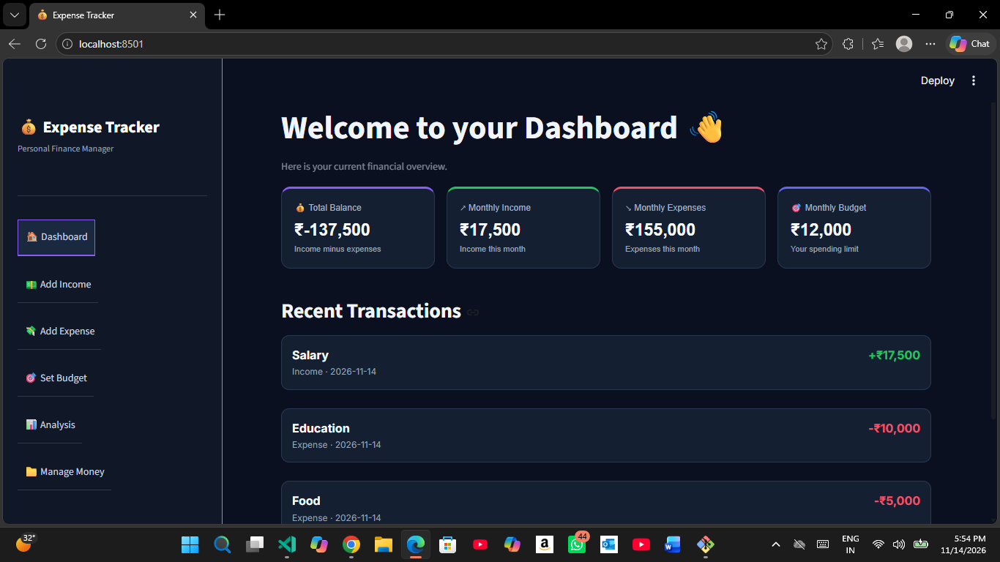
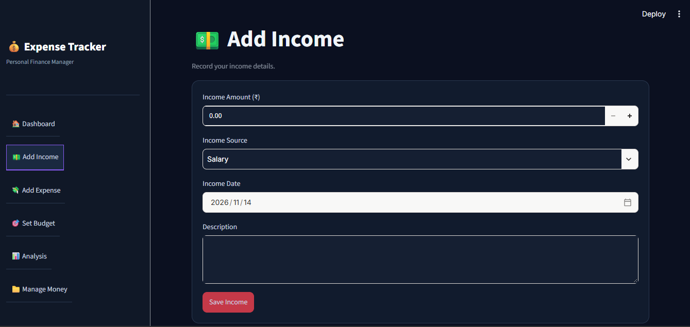
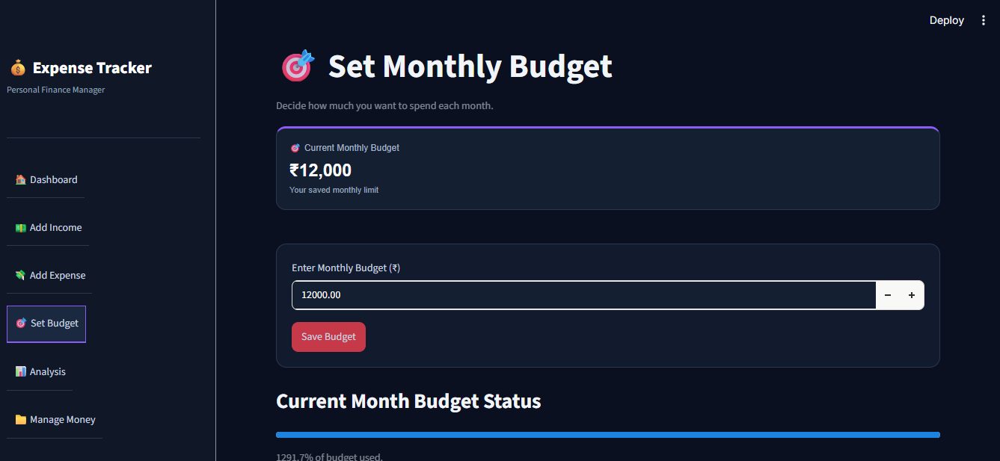

# 💰 Expense Tracker

<p align="center">
  
</p>

<p align="center">
  <b>A Personal Expense Management Application built with Python and Streamlit.</b>
  <br>
  Track expenses, manage money and understand your financial activities through an interactive dashboard.
</p>

<p align="center">
  
  
  
  
</p>

---

## 📌 Overview

Expense Tracker is a personal finance management application developed using Python and Streamlit.

The application provides an interactive interface for managing expenses, monitoring financial activities and analyzing expense data.

It includes dedicated sections for Dashboard, Analysis, Add Expense and Manage Money, making financial tracking more organized and accessible.

## ✨ Features

- **Dashboard:** View an overview of financial activities.
- **Add Expense:** Add and manage expense records.
- **Analysis:** Explore expense data through visualizations.
- **Manage Money:** Manage financial records through a dedicated interface.
- **Interactive Interface:** Navigate through different application sections using Streamlit.

## 🖥️ Application Preview

### 1. Dashboard

Get an overview of your financial activities.


### 2. Expense Analysis

Explore and visualize expense-related information.



### 3. Add Expense

Add expense records through the application interface.


### 4. Manage Money

Manage your financial records.



---

## 🛠️ Tech Stack

| Technology | Purpose |
|---|---|
| Python | Core application development |
| Streamlit | Interactive application interface |
| Pandas | Data manipulation and analysis |
| Plotly | Data visualization |
| ReportLab | PDF document generation |
| Charset Normalizer | Character encoding support |
| UV | Dependency and environment management |

## 📁 Project Structure

```text
expense-tracker/
│
├── screenshots/
│   ├── dashboard.png
│   ├── analysis.png
│   ├── add-expense.png
│   └── manage-money.png
│
├── src/
│   └── expences_tracking_system/
│
├── .gitignore
├── .python-version
├── pyproject.toml
├── uv.lock
└── README.md
```

## ⚙️ Installation & Setup

### Prerequisites

- Python 3.14
- Git
- UV package manager

### 1. Clone the repository

```bash
git clone https://github.com/VINAYSH778/expense-tracker.git
```

### 2. Navigate to the project directory

```bash
cd expense-tracker
```

### 3. Install UV

```bash
pip install uv
```

### 4. Install dependencies

```bash
uv sync
```

### 5. Run the application

The project defines the following command-line entry point in `pyproject.toml`:

```bash
uv run expences-tracking-system
```

If you use Streamlit's direct launch command instead, use the actual application entry-point file:

```bash
uv run streamlit run path/to/main.py
```

Replace the path with the actual location of your main application file.

## 🎯 Project Objectives

- Develop a practical Python application.
- Understand interactive application development using Streamlit.
- Work with data manipulation using Pandas.
- Explore data visualization using Plotly.
- Practice Python project organization and dependency management using UV.

## 🚀 Future Improvements

- Add monthly and yearly financial summaries.
- Introduce budget planning and spending limits.
- Add category-wise expense reports.
- Improve data export and reporting options.
- Add automated testing and input validation.

## 👨‍💻 Author

**Vinay Sharma**

GitHub: [@VINAYSH778](https://github.com/VINAYSH778)

---

<p align="center">
  If you find this project interesting, consider giving it a ⭐
</p>
